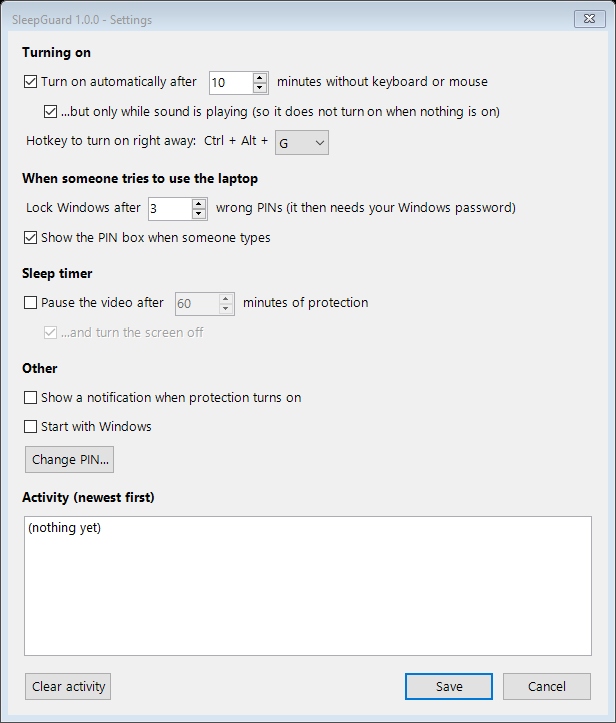

# SleepGuard

**Fall asleep watching something without anyone else using your laptop.**

SleepGuard keeps your video playing **on screen**, but blocks the keyboard and mouse until your PIN is typed.
It turns on by itself when you stop touching the laptop, or with a hotkey. Nothing covers the video: no lock
screen, no overlay.



## What happens
1. You watch a video (YouTube, a film, anything).
2. After 10 minutes without keyboard or mouse input, while sound is playing, SleepGuard turns on silently.
   Or press **Ctrl+Alt+G** to turn it on right away.
3. The video keeps playing. Clicks, scrolling, every key, Alt+Tab, the Windows key and Alt+F4 do nothing.
   The pointer still moves, but cannot click anything.
4. When someone types, a small box asks for the PIN. It does not take focus from the video and disappears
   after a few seconds.
5. Type the PIN and press **Enter**: everything works again. If there were wrong attempts while it was on,
   you get a notification such as "2 wrong PIN attempts, last at 01:12".
6. After 3 wrong PINs, **Windows itself locks**, so further guessing needs your Windows password.

**Forgot the PIN?** Press Ctrl+Alt+Del, choose **Lock**, and sign in with your Windows password. SleepGuard
turns off by itself when you unlock Windows.

## Settings
Right-click the tray icon (a "Z" in a circle: grey = off, red = on) and choose **Settings and activity**.

| Setting | Default |
|---|---|
| Turn on automatically after N minutes without keyboard or mouse (1-240) | on, 10 minutes |
| ...but only while sound is playing, so it does not turn on when nothing is on | on |
| Hotkey to turn on right away: Ctrl + Alt + a letter of your choice | G |
| Lock Windows after N wrong PINs (1-10) | 3 |
| Show the PIN box when someone types | on |
| Sleep timer: pause the video after N minutes of protection, and optionally turn the screen off | off, 60 minutes |
| Show a notification when protection turns on | off |
| Start with Windows | off |
| Change PIN | |

The window also shows the **activity log**: when protection turned on and off, and every wrong PIN with its
time.

## Install
1. Download `SleepGuard-vX.Y.Z.zip` from [Releases](../../releases) and extract it anywhere.
2. Run `SleepGuard.exe` and choose a PIN (at least 4 digits or letters; letters are not case-sensitive).
3. It runs in the tray. Tick **Start with Windows** in Settings to keep it there.

No installer, no admin rights, no driver. Needs Windows 7-11 with .NET Framework 4.x (already part of Windows).
Windows SmartScreen may warn because the program is not code-signed: **More info → Run anyway**.

## Limits (by Windows design)
- **Ctrl+Alt+Del cannot be blocked** by any program. Everything it offers (Lock, Switch user, Sign out) needs
  your Windows password to get back in, so it does not give anyone access. Signing out does stop the video.
- **Win+L** (lock) cannot be blocked either. It only locks the PC.
- It does not stop someone from physically taking the laptop.
- It only helps if your Windows account has a password or PIN.
- Windows can silently drop a keyboard/mouse block in rare cases; SleepGuard re-attaches it every minute.
- If SleepGuard is closed or crashes, input works again (it never leaves the PC unusable).

## How it works
Low-level keyboard and mouse hooks (`WH_KEYBOARD_LL`, `WH_MOUSE_LL`) swallow every key press and every click
or scroll while protection is on; mouse movement passes through. The PIN is read from the swallowed keys and
checked against a salted PBKDF2 hash in `%AppData%\SleepGuard\settings.ini`; the PIN itself is never stored.
Idle time comes from `GetLastInputInfo`, "sound is playing" from the Windows Core Audio peak meter, and the
sleep timer presses the media Play/Pause key (marked so SleepGuard's own block lets it through).

## Build
```
build.cmd
```
Uses the C# compiler that ships with Windows. Output: `bin\SleepGuard.exe`.

| File | Purpose |
|---|---|
| `src/GuardApp.cs` | Tray app, turning on/off, PIN entry, sleep timer, hotkey |
| `src/InputBlocker.cs` | The keyboard and mouse block |
| `src/SettingsForm.cs` | Settings window and activity log view |
| `src/PinSetup.cs` / `src/PinPrompt.cs` | Choosing the PIN / the box shown while someone types |
| `src/Settings.cs` | Settings and the PIN hash |
| `src/Activity.cs` | Activity log |
| `src/Native.cs` | Idle time, Windows lock, media key, display off, sound meter |

## Uninstall
Tray icon → **Exit**, untick Start with Windows first if you ticked it, then delete the folder and
`%AppData%\SleepGuard`.

## License
MIT, see `LICENSE`.
